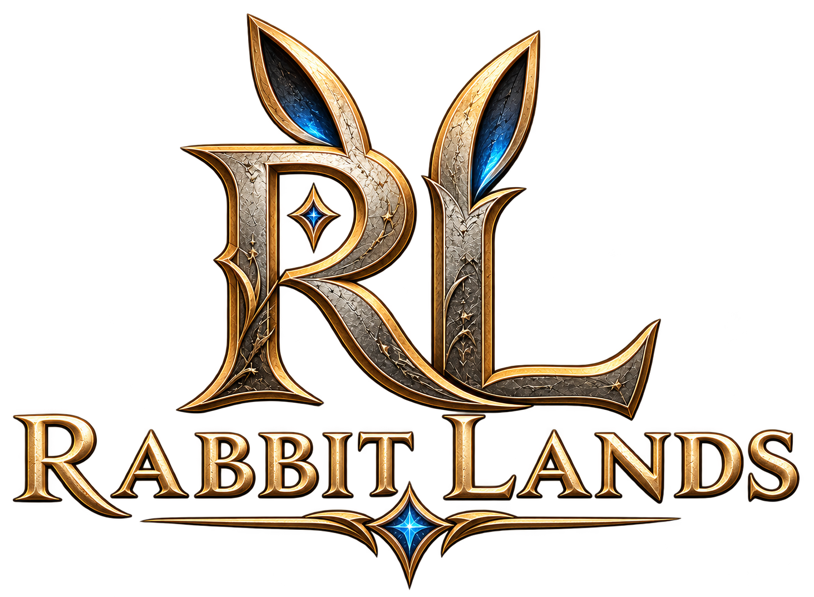

# Rabbit Lands Client



[Brand artwork and usage](godot-client/assets/branding/README.md)

**Rabbit Lands (RL)** is an independently developed fantasy MMORPG featuring
exploration, combat, crafting, magic, character progression and a persistent
multiplayer world. Its name is a lighthearted nod to classic MMORPG traditions;
the fantasy setting and gameplay retain a serious, immersive design. The world
itself is called **Eloria**.

This repository contains the Godot 4.7 client and its asset sources. Rabbit Lands
is not affiliated with or endorsed by Eternal Lands or its developers. The old C
client and its game data were removed on 2026-09-03; retained license notices and
[the legacy modification record](ELORIA_MODIFICATIONS.md) document that origin.

Website: <https://rabbitlandsgame.com> ·
Client: <https://github.com/rabbitlandsgame/rabbitlands-client> ·
Server (private): <https://github.com/rabbitlandsgame/rabbitlands-server>

## Layout

| path              | what it is                                                        |
|-------------------|-------------------------------------------------------------------|
| `godot-client/`   | the client. A Godot 4.7 project; open it with the project root at `godot-client`. |
| `eloria-assets/`  | asset sources: map packages, concept art, QA renders, and the tools that build them. |
| `tools/`          | shared build tools that are not part of either tree.               |
| `tests/`          | Python contracts over the shared assets. `python3 -m pytest tests`. |
| `docs/`           | audits and format notes.                                          |

The client reads a few asset sources in place through `res://../eloria-assets/`,
so the two directories are checked out together and move together.

## Running

```bash
godot --path godot-client
```

The client defaults to verified TLS at `game.rabbitlandsgame.com:2001`.
Certificates and the hostname are verified, and failed TLS connections never
fall back to plain TCP. Older saved settings are migrated to enable TLS;
there is no player-facing encryption switch. Point at another TLS server with
the login screen's server field, or `-- --server=HOST --port=PORT`.

For a local `rabbitlands-server` without TLS, launch with
`-- --dev-plain-tcp`. This developer option defaults to `127.0.0.1:2000`;
`--server` and `--port` can override that address. It applies only to this
launch and is never saved as a player preference. Local integration fixtures
that use an unencrypted server also need this option unless they opt in directly.
DNS, hosting and certificates must be configured separately;
these names are configuration defaults, not a claim of live service.

Player downloads are built with `godot-client/tools/package_client.py`.
The package includes signed background updates and a restart installer;
see [building and publishing client updates](docs/client-updates.md).
Maintainers can use `godot-client/tools/build_release.py` to build both Windows
and Linux downloads and replace the current GitHub release, starting as a draft.
Only the latest compiled build is retained on GitHub.
The Windows download is a small setup executable that downloads and verifies
the game files during installation. Linux uses the supplied portable archive.

Maintainers can also prepare complete [Steam depots and macOS test bundles](docs/store-builds.md).
Steam manages updates for its builds; the GitHub installers keep their existing
signed update path. The same guide tracks the remaining Steam Deck and Android work.

For the integrated **Last Lantern** opening adventure, run
[`prototypes/last-lantern/play.cmd`](prototypes/last-lantern/play.cmd). It starts
the real client and a loopback dev-server with a separate local character database.
See the [integration notes](docs/last-lantern-integration.md).

Continue with **The Second Bell**, a private invasion adventure on Bellwatch's
four-gate map. After The Last Lantern, talk to Ilyon or enter `#tutorial invasions`
in chat. See the [play instructions and verification](docs/invasion-tutorial/implementation.md).

**The Borrowed Sky** teaches magic in Stillglass Observatory through the actual
spellbook and gameplay. Enter `#tutorial magic` for the private four-gate rescue;
afterward, `#tutorial magic a` through `d` open its optional experiments. Borrowed
attunement and supplies use a separate saved practice profile. See the
[play instructions and verification](docs/magic-tutorial/implementation.md).

Select a spell in **Spells** to read its description and watch a looping effect
preview at the selected power. Descriptions and previews remain visible while
browsing, including for spells you cannot yet cast.

Storage opens in the compact classic layout. Right-click its title to choose
**Docked bank**, which moves storage and inventory together; the choice is
remembered. The inventory's blue quantity shortcuts also control storage
withdrawals and deposits. Double-click a stored item to withdraw it.
You can walk with storage open by clicking the world, Tab map or minimap.
Storage closes automatically when you reach eight tiles from its keeper or chest.

Use the first eight backpack slots from the item quick bar with **1–8** or
**Ctrl+1–8**. Hover a slot to see its active shortcuts, quantity and cooldown.
Rebind item shortcuts in **Settings → Controls**.

**Item Lists** opens named favorite sets. Create a list, add selected items with
**+**, and edit each item's quantity. Clicking a list name swaps the favorite
grid immediately. **Get list** tops up matching backpack quantities from the
open storage category; double-click a favorite from another category to open
that category, then click it again after loading. Lists, quantities, and the
active set are saved between sessions.

## Audio

The game uses free online recordings and music with retained CC0 and CC BY 3.0
licenses. Open **Settings → Audio credits** for creators, sources and licenses.
See [audio sources and rebuilding](eloria-assets/source/audio/README.md).
Game packages include `AUDIO-CREDITS.txt` and the full audio license texts.

## Optional developer checks

```bash
python3 -m pytest tests
python3 eloria-assets/tools/check_provenance.py
godot --headless --path godot-client --script res://tests/test_protocol.gd
godot --headless --path godot-client --script res://tests/test_classic_storage.gd
```

`check_provenance.py` fails if an Eternal Lands map name or engine file format
(`.elm`, `.e3d`, Cal3D, `.dds`, `.bmp`) appears anywhere in the tree. The retained
tests are optional; run the focused checks relevant to a change. The
[desktop release workflow](docs/runner-builds.md) builds signed Windows and
Linux downloads after merges into `master` and supports manual runs. It does
not impose the historical suites as merge checks.

## Maps

Add a personal named marker at your current position with `#mark Reed bank`.
Use `#markpos 100 200 Ferry` to mark specific coordinates, `#marks` to list your
markers on the current map, and `#unmark Reed bank` to remove one from that map.
Names can contain spaces. Reusing a name on the same map moves that marker;
other maps can have their own markers with the same name. Press **Tab** to see
your markers on the full map, with names and coordinates in its sidebar and
names on hover. Markers are private to your local client and saved between
sessions.

A map is a GLB scene, a `world.json` manifest and a `collision.bin` walk grid
under `eloria-assets/maps/`. `godot-client/data/maps/registry.json` binds each
**stable map id** — `four_gates`, `westhaven` — to its manifest and to the
coordinate transform that puts the server's tiles on the authored geometry.

rabbitlands-server sends that id. It used to send the path of an Eternal Lands map
file instead; `MapRegistry.normalize_server_map_id` still reduces a path-shaped
name to its id, as tolerance for an older server rather than as a contract.
`tests/test_protocol.gd` holds every registry key to a bare id, and the server
holds the other half in its `tests/test_client_content_sync.py`.

Server walk grids for the composed interior maps live in
`eloria-assets/maps/nymara-regions/server-collision/`; see that directory's
README for the format and for how rabbitlands-server reads them.
